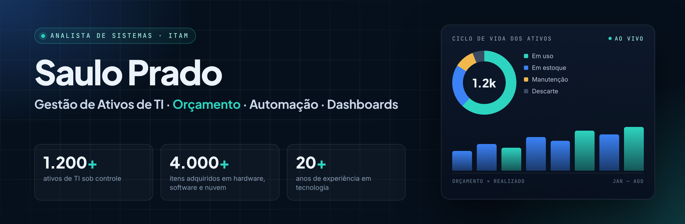

  

## Olá, eu sou o Saulo 👋

Analista de Sistemas com ênfase em **Gestão de Ativos de TI** e mais de **20 anos de experiência** em tecnologia.

Atuo com o controle de mais de **1.200 ativos** e a aquisição de mais de **4.000 itens** de hardware, software e nuvem, cuidando do ciclo de vida dos ativos do planejamento ao descarte.

Desenvolvo **processos automatizados** e **dashboards em tempo real** para rastreamento, orçamento e conformidade, com foco em visibilidade total, redução de custos e alinhamento entre TI e negócio.

## O que eu faço

| | Área | Na prática |
| :---: | --- | --- |
| 📦 | **Gestão de Ativos de TI (ITAM)** | Inventário, ciclo de vida, rastreamento e conformidade de hardware e licenças |
| 💰 | **Orçamento e aquisições** | Planejamento e acompanhamento de compras de hardware, software e nuvem |
| ☁️ | **Custos de nuvem** | Acompanhamento e rateio de faturas de nuvem entre áreas |
| ⚙️ | **Automação** | Scripts e fluxos que eliminam tarefas repetitivas e reduzem erros |
| 📊 | **Dashboards** | Painéis em tempo real para gestão, orçamento e tomada de decisão |

## Ferramentas

## Projetos em destaque

| Projeto | O que é | Stack |
| --- | --- | --- |
| [**Python Scripts**](https://github.com/sauloprado/Python-Scripts---Saulo-Prado) | Automações do dia a dia: notícias de IA com React + SQLite, cofre de senhas criptografado e acesso automatizado com Selenium | Python · Flask · React · SQLite |
| [**Mastering Python 2026**](https://github.com/sauloprado/Mastering-Python-2026) | Estudo e portfólio técnico: CPython moderno, dados em alta performance e agentes de IA | Python · Pandas · Polars |
| [**Myícone 2026**](https://github.com/sauloprado/Myicone2026) | Releitura moderna do portal de atalhos Myícone, com tema claro/escuro e busca em tempo real | React · TypeScript · Vite |
| [**Dr. LinkedIn — Site**](https://github.com/sauloprado/Dr-Linkedin-Site) | Landing page editorial para a marca Dr. LinkedIn | HTML · CSS · React |
| [**Palazzo**](https://github.com/sauloprado/Palazzo) | Site da Palazzo Publicidade, em transição do legado para Next.js + Payload CMS | Next.js · TypeScript · PHP |

## Também faço

🧱 **[PL Stack](https://plstack.com.br)** — sites, sistemas e automações para empresas: criação de sites em WordPress, painéis e integrações.

## Trilha de estudos

Aprendizado contínuo, com o histórico versionado aqui no GitHub:

- 🔄 [Desenvolvimento Web Completo — 20 cursos + 20 projetos](https://github.com/sauloprado/fullstack-web-20cursos-20projetos) *(em andamento)*
- 📦 Arquivados como histórico: [HTML5 & JavaScript — 20 projetos](https://github.com/sauloprado/Html5-Js-20-projetos) · [Bootstrap (Hcode)](https://github.com/sauloprado/Curso-Hcode-Bootstrap) · [HTML5 (Hcode)](https://github.com/sauloprado/Curso-Html5-Hcode) · [Git e GitHub](https://github.com/sauloprado/Projeto-Curso-Git) · [Python 2019](https://github.com/sauloprado/Python) · [HTML5 Fundamentos](https://github.com/sauloprado/HTML5-Intro-MatheusBattisti) · [GPT customizado (DIO)](https://github.com/sauloprado/Projeto-GPT-DIO)

## Contato

📍 Campinas, SP · Brasil
